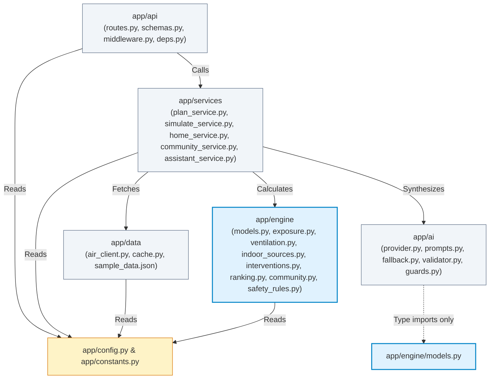
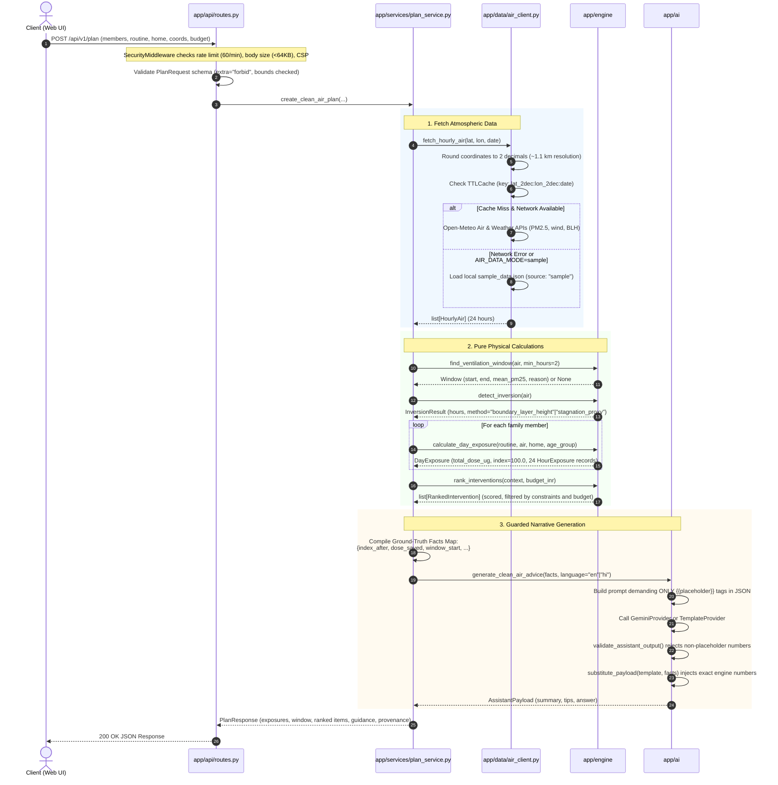

# AirPlan System Architecture

This document describes the architectural layers, import boundaries, data lifecycle for plan generation, and the mathematical guarantees that prevent generative AI hallucinations in AirPlan.

---

## 1. Architectural Layers & One-Way Import Rules

AirPlan enforces a strict, hierarchical **one-way import policy**:



### Import Rules & Invariants
1. **API Layer (`app/api`)**:
   - Imports exclusively from `app/services`, `app/config.py`, `app/constants.py`, and `app/errors.py`.
   - Never contains business or domain logic. Routes strictly parse HTTP payloads, delegate execution to a dedicated service function, and return typed Pydantic models.
   - All route handlers are constrained to $\le 15$ lines of code.

2. **Service Layer (`app/services`)**:
   - Acts as the orchestrator. Coordinates domain computations by calling `app/engine`, fetches atmospheric observations from `app/data`, and requests structured narrative generation from `app/ai`.
   - Manages stateful persistence for community actions (in-memory, thread-safe).

3. **Pure Domain Engine (`app/engine`)**:
   - **Zero External Dependencies**: Imports nothing from `app/api`, `app/services`, `app/data`, or `app/ai`.
   - **100% Deterministic & Pure**: No filesystem I/O, no network calls, no process globals, no `datetime.now()` or `datetime.utcnow()`, and no `random` operations.
   - **Injected Parameters**: All temporal parameters (e.g. date, hour) are passed into functions as explicit arguments.
   - Numerical simulations are repeatable and provable via property-based invariant testing (Hypothesis).

4. **Data Layer (`app/data`)**:
   - Fetches atmospheric data from external APIs (Open-Meteo) using `httpx` with timeout and retry policies.
   - Caches responses in a memory-bounded, 15-minute `TTLCache`.
   - Automatically falls back to local curated Delhi winter smog data (`sample_data.json`) during network disconnection or rate limits.
   - Imports nothing from `app/engine` or `app/ai`.

5. **AI Layer (`app/ai`)**:
   - Provides guarded LLM integration (Gemini 2.5 Flash) and instant deterministic template fallbacks.
   - Allowed to import data contracts only from `app/engine/models.py`.
   - Never calls database or atmospheric clients directly.

---

## 2. End-to-End Data Flow of `/plan`

The `POST /api/v1/plan` endpoint illustrates the complete journey of user data through the layered architecture:



---

## 3. Why the LLM Cannot Invent Numbers

In conventional AI applications, generative models hallucinate statistics, misquote thresholds, or give contradictory recommendations. AirPlan eliminates numerical hallucinations through **structural constraint, syntactic validation, and deterministic backend substitution**:

### 1. Separation of Physics from Prose
The generative model is never asked to calculate doses, reductions, percentages, or concentrations. All mathematical operations are evaluated before the AI layer is invoked:
$$\text{inhaled\_dose}(t) = \text{PM}_{2.5}(t) \times \text{microenvironment\_factor} \times \text{breathing\_rate}(\text{activity}, \text{age})$$
$$\text{score} = \frac{\text{impact} \times \text{feasibility}}{1 + \frac{\text{cost}}{\text{COST\_NORMALIZATION}} + \frac{\text{effort}}{\text{EFFORT\_MAX}}}$$

### 2. Strict Template Placeholder Specification
The system prompt explicitly commands the model to return a structured JSON object containing **placeholders only**:
```json
{
  "summary": "By shifting high-exertion routines and sealing leaks, your household can reduce inhaled dose by {{dose_saved}} ug (Relative Exposure Index: {{index_after}}).",
  "tips": [
    "Natural window airing is safest between {{window_start}}:00 and {{window_end}}:00.",
    "Deploy a DIY air cleaner during night-time stagnation hours."
  ],
  "answer": "Plan verified against deterministic aerosol calculations."
}
```

### 3. Server-Side AST & Regex Verification
Before any text is presented to the user, `app/ai/validator.py` applies structural validation rules:
- **Zero Unapproved Numbers**: The validator scans all string values in the JSON output. Any bare numeric digit outside an allowed tag format (e.g. `{{index_after}}`) causes immediate validation failure.
- **Allowed Placeholder Whitelist**: Only registered tokens (`{{index_after}}`, `{{dose_saved}}`, `{{window_start}}`, `{{window_end}}`, `{{intervention_1}}`, `{{intervention_2}}`) are permitted.
- **Key Whitelist**: Only `"summary"`, `"tips"`, and `"answer"` keys are allowed (`extra="forbid"`).

### 4. Deterministic Substitution Pipeline
Once the JSON response passes syntax and placeholder validation:
```python
# Exact numbers computed exclusively by Python engine:
facts = {
    "index_after": "61.6",
    "dose_saved": "38.4",
    "window_start": "13",
    "window_end": "15",
}
# Pure string substitution with zero LLM re-generation:
final_output = substitute_payload(validated_template, facts)
```

### 5. Automated Fallback Safety Net
If the LLM generates hallucinated digits, malformed JSON, or fails network connectivity, the system does not fail or retry with temperature variations. It drops immediately to [app/ai/fallback.py](app/ai/fallback.py), which renders pre-compiled, linguistically verified templates in English or Hindi.

---

## 4. Frontend Architecture: Zero-Build, Zero-innerHTML

The client-side interface resides in `static/` and adheres to three fundamental constraints:
1. **Zero committed `node_modules` or bundlers**: Built with pure standard ECMAScript modules (`<script type="module">`).
2. **Strict Zero-`innerHTML` Policy**: Protects against Cross-Site Scripting (XSS). All elements are instantiated using `document.createElement()`, `element.textContent`, and DOM manipulation.
3. **Reactive Single-Directional State Store**: [static/js/state.js](static/js/state.js) acts as the single source of truth with immutable notifications to registered UI rendering components.
