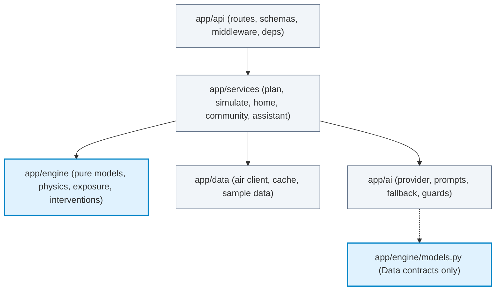

# AirLedger System Architecture

AirLedger adheres to a **strict, one-way import architecture**:

---

## Architectural Boundaries

1. **One-Way Import Rules**:
   - `app/api` imports only from `app/services`, `app/config.py`, `app/constants.py`, and `app/errors.py`.
   - `app/services` coordinates domain logic, calling `app/engine`, `app/data`, and `app/ai`.
   - `app/engine` is completely pure. It imports nothing from any other `app` subpackages.
   - `app/ai` may import `app/engine/models.py` for typed data containers only.
   - `app/data` imports nothing from `app/engine` or `app/ai`.
   - `app/api` never contains business logic; it strictly parses requests, calls a service, and returns structured responses.

2. **Engine Purity**:
   - Zero I/O operations, zero network requests, zero globals.
   - No `datetime.now()` or `random()`. All dates and times are injected as explicit parameters.
   - Deterministic mass-balance differential box models with numerical stability.

3. **Domain Constants & Provenance**:
   - All physical parameters, regulatory thresholds (WHO 15 $\mu\text{g/m}^3$, Indian NAAQS 60 $\mu\text{g/m}^3$), emission rates, and costs live in `app/constants.py` as typed constants with units.
   - Every domain output quantity carries a `Provenance` (stated assumption and confidence rating: `low` | `medium` | `high`).

