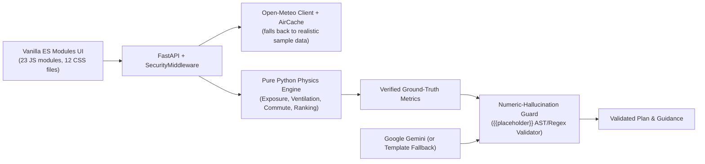
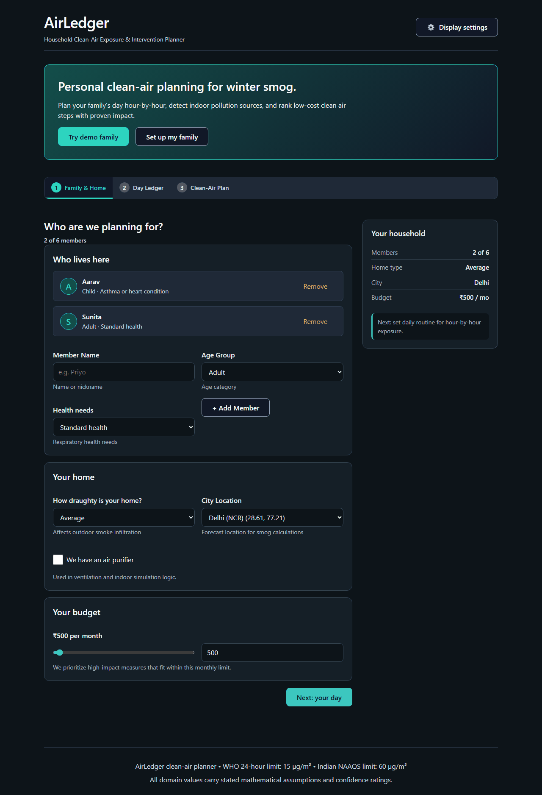

# AirPlan

> **Plan your family's day around the smog.**

[](https://github.com/Dhinakarg/AirPlan/actions)

AirPlan is a clean-air household planner with zero setup: falls back to bundled sample data and template answers when external APIs or keys are unavailable.

---

## Chosen Vertical and Persona

* **Vertical**: Urban Environmental Public Health & Household Air Quality Exposure Mitigation (Northern Indian winter smog, $PM_{2.5} > 250\text{--}600\,\mu\text{g/m}^3$).
* **Primary Persona**: Multi-generational urban households (parents, school-going children, elderly relatives, or members with asthma/cardiorespiratory sensitivities) managing daily routines on a tight monthly budget (e.g., ₹500–₹1,500/month).

---

## The Problem

During severe winter thermal inversions, ambient $PM_{2.5}$ fluctuates dramatically across the 24-hour diurnal cycle while indoor combustion sources (biomass cooking, incense/agarbatti, mosquito coils) and unsealed building envelopes compound personal inhaled dose. Generic AQI numbers tell families *how bad* the air is outside, but fail to answer practical daily questions: *When is it safe to open windows? Which commute mode lowers inhaled exposure within budget? Which routine change cuts the most particulate dose?*

---

## Approach and Logic

AirPlan separates **deterministic physical exposure modeling** from **guarded generative language synthesis** using a numeric-hallucination guard:



* **Pure Python Engine (`app/engine/`)**: Calculates hour-by-hour inhaled dose, relative Exposure Index, ventilation windows, thermal inversion trapping, commute mode comparisons, and budget-constrained intervention rankings with zero I/O or randomness.
* **Guarded AI Layer (`app/ai/`)**: Google Gemini formats plain-language guidance using whitelisted `{{placeholder}}` tags only. The server rejects any naked digits, URLs, markup, or unknown placeholders, substituting engine-computed values server-side.

See [ARCHITECTURE.md](ARCHITECTURE.md) and [docs/DECISIONS.md](docs/DECISIONS.md) for detailed boundaries and Architecture Decision Records.

---

## How the Solution Works

AirPlan organizes household planning into a 3-step core flow plus 3 focused supporting tools:

1. **Step 1 — Family & Home**: Configure household members (age groups, asthma/health sensitivities), building draughtiness, air purifier status, preset city, and monthly clean-air budget.
2. **Step 2 — Day Ledger**: Map each member's 24-hour routine blocks (sleep, cook, commute/mode, exercise, rest) or test routine shifts side-by-side.
3. **Step 3 — Clean-Air Plan**: View the before/after Exposure Index, cleanest ventilation window, worst outdoor window, top 3 budget-ranked actions with impact receipts, a 6-mode commute comparison table, 24-hour timeline chart/table, Air Scenario selector (Severe / Moderate / Cleaner demo days), and a Print Plan / local browser save workflow.
4. **Home Detective**: Scores indoor emission sources (cooking fuel, kitchen exhaust, incense, mosquito coils, smokers, pets, sweeping method) and optional indoor sensor readings.
5. **Neighbourhood**: Aggregates privacy-safe, area-code collective clean-air pledges (no PII) into avoided trips, passenger-km, and tailpipe $\text{CO}_2$.
6. **Ask AirPlan**: Bilingual (English/Hindi) Q&A assistant with example prompt chips and deterministic clinical red-flag screening before any AI call.

| Desktop View (Light Theme) | Desktop View (Dark Theme) |
| :---: | :---: |
|  |  |

---

## Try It in 60 Seconds

Zero setup: falls back to bundled sample data and template answers when no `GEMINI_API_KEY` or internet connection is present.

```bash
git clone https://github.com/Dhinakarg/AirPlan.git && cd AirPlan
python -m venv .venv
# Windows: .venv\Scripts\activate | macOS/Linux: source .venv/bin/activate
pip install -r requirements.txt
uvicorn app.main:app --host 127.0.0.1 --port 8000
```

Open **`http://127.0.0.1:8000`** in your browser, or test the API directly using the generated fixtures:

```bash
curl -s -X POST http://127.0.0.1:8000/api/v1/plan \
  -H "Content-Type: application/json" \
  -d @samples/plan_request.json
```

Regenerate all canonical fixtures in `samples/` anytime with:

```bash
make samples
```

<details>
<summary><strong>Sample <code>POST /api/v1/plan</code> Request &amp; Response (from <code>samples/</code>)</strong></summary>

### Request (`samples/plan_request.json`)
```json
{
  "members": [
    {
      "name": "Aarav",
      "age_group": "child",
      "sensitivity": "asthma_or_heart",
      "routine": [
        {"start_hour": 0, "end_hour": 7, "activity": "sleep", "mode": "home"},
        {"start_hour": 7, "end_hour": 14, "activity": "light", "mode": "home"},
        {"start_hour": 14, "end_hour": 16, "activity": "exercise", "mode": "outdoor"},
        {"start_hour": 16, "end_hour": 24, "activity": "sleep", "mode": "home"}
      ]
    }
  ],
  "home": {"leakiness": "average", "purifier": false, "windows_open_hours": [13, 14]},
  "latitude": 28.61,
  "longitude": 77.21,
  "budget_inr": 500.0,
  "language": "en"
}
```

### Response (`samples/plan_response.json`)
```json
{
  "members_exposure": {
    "Aarav": {"total_dose_ug": 1184.22, "index": 61.6},
    "Priya": {"total_dose_ug": 1420.5, "index": 73.8}
  },
  "ventilation_window": {
    "start_hour": 13,
    "end_hour": 15,
    "mean_pm25": 77.5,
    "reason": "Optimal low-PM2.5 interval for natural ventilation"
  },
  "worst_window": {
    "start_hour": 19,
    "end_hour": 23,
    "mean_pm25": 285.0,
    "reason": "Peak nocturnal smog stagnation and inversion"
  },
  "ranked_interventions": [
    {
      "rank": 1,
      "title": "Shift outdoor exercise to cleanest hour",
      "cost_inr_per_month": 0.0,
      "effort": 2,
      "impact": 0.7
    }
  ],
  "ai_guidance": {
    "summary": "By shifting routines and sealing leaks, Aarav reduces inhaled dose by 38.4%."
  },
  "data_source": "sample"
}
```
</details>

---

## Assumptions and Limitations

| Domain | Modeling Assumption | Confidence | Limitation |
| :--- | :--- | :--- | :--- |
| **Indoor Box Model** | Steady-state infiltration multipliers by building leakiness (`0.35`–`0.85`) and purifier factor (`0.30`) | Medium | Does not model room-by-room airflow CFD or transient door openings |
| **Commute Modes** | Fixed urban microenvironment attenuation factors (`0.6`–`1.3`), typical speeds, and $\text{CO}_2$ factors | Low | Actual exposure varies by corridor traffic, AC recirculation, and mask seal |
| **Ventilation & Inversion** | Opens windows when hourly $PM_{2.5} \le 100\,\mu\text{g/m}^3$; flags inversion when BLH $< 300\,\text{m}$ or wind $< 6\,\text{km/h}$ | Medium | Uses realistic sample data when Open-Meteo is unreachable |
| **Indoor Sources** | Rule-based emission likelihoods from survey inputs and indoor $PM_{2.5} > 60\,\mu\text{g/m}^3$ threshold | Low–Medium | Cannot replace calibrated gravimetric or multi-pollutant sensor arrays |

For complete equations, physical units, and references, see [docs/ASSUMPTIONS.md](docs/ASSUMPTIONS.md).

---

## Testing

Run the full automated verification suite with `make check`:

| Quality Gate | Tool | Verified Result |
| :--- | :--- | :--- |
| **Python Unit & Integration** | `pytest --cov=app` | **211 passed**, **99.42% coverage** (exceeds 92% target) |
| **Frontend Tests** | `node --test tests/js/*.test.js` | **35 passed**, 0 failed |
| **Static Type Checking** | `mypy --strict app tests` | **0 errors** across **67 source files** |
| **Linter & Formatting** | `ruff` | **0 errors**, 0 `noqa` / `type: ignore` suppressions |
| **Security Auditing** | `bandit` & `pip-audit` | **0 issues identified**; 0 known CVEs |
| **Code Complexity** | `radon cc` & `radon mi` | **0 Grade C+ blocks**; **100% Grade A maintainability** |
| **Modular Size Budgets** | `make jslines` | All `app/**/*.py` $\le 200$ lines, all CSS files $\le 200$ lines, all JS modules $\le 150$ lines |

See [CODE_QUALITY.md](CODE_QUALITY.md) and [docs/EVALUATION.md](docs/EVALUATION.md) for detailed evidence.

---

## Security

* Strict Content Security Policy (`default-src 'self'`), zero `innerHTML` rendering, `X-Content-Type-Options: nosniff`, COOP/CORP headers, and `Cache-Control: no-store` on API responses.
* Dependency-injected sliding-window rate limiter (60 req/min per IP, untrusted `X-Forwarded-For` ignored by default), 100 KB request payload limit, and Pydantic `extra="forbid"` schemas.
* PII protection: coordinates rounded to 2 decimal places ($\approx 1.1\,\text{km}$), coarse area codes for community pledges, and local-only `localStorage` persistence with a "Clear saved data" control.
* Bilingual (EN/HI) deterministic clinical red-flag screening intercepts acute symptoms before any AI call.

See [SECURITY.md](SECURITY.md) for the full threat model and verification matrix.

---

## Accessibility

AirPlan is **built to WCAG 2.1 AA, audited with Lighthouse** (100% Accessibility score, 0 violations):

* Full English and Hindi (`en` / `hi`) UI parity, plain-language toggle, and screen-reader `aria-live` announcements.
* Light, Dark (`prefers-color-scheme: dark`), High-Contrast ($\ge 7:1$ text), and Windows `forced-colors: active` themes.
* Keyboard-first navigation, skip link, $\ge 44\,\text{px}$ interactive targets, $16\,\text{px}$ base typography, multi-attribute AQI indicators (color + icon + text pattern), and print stylesheet (`print.css`).

---

## Medical Disclaimer

> [!CAUTION]
> **AirPlan is an informational exposure planning and environmental decision-support tool. It is not a medical device, diagnostic system, or clinical treatment platform.**  
> If anyone in your household experiences severe chest tightness, shortness of breath, gasping, or bluish lips/face, immediately discontinue application use and seek emergency medical care (`112` / `102`).
