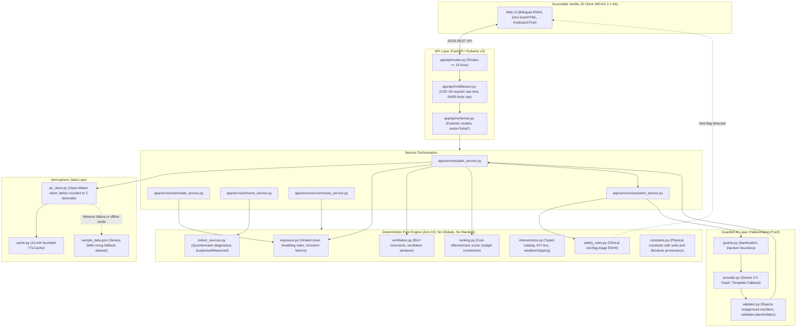

# AirLedger

> **GenAI-assisted household clean-air planner for families and communities facing severe winter smog.**

AirLedger is an open-source, offline-first clean-air planner built specifically for households in the Indo-Gangetic Plain and urban Global South (e.g., Delhi-NCR, Lahore, Patna, Lucknow) navigating hazardous winter air pollution ($PM_{2.5} > 250\text{--}600\,\mu\text{g/m}^3$). It models personalized hour-by-hour particulate exposure per family member, detects high-emission indoor sources, discovers atmospheric ventilation windows, ranks low-cost interventions with transparent physical receipts, and answers clean-air inquiries with verifiable, hallucination-free guidance.

---

## Target Persona & Problem Statement

### Target Persona
- **Primary Persona**: Multi-generational households in dense urban/peri-urban settlements facing seasonal winter smog episodes. Families typically include high-vulnerability members: infants/toddlers with developing lungs, elderly members with cardiovascular vulnerabilities, pregnant women, and individuals with diagnosed asthma or COPD.
- **Economic Reality**: Low-to-middle income families unable to spend ₹30,000–₹60,000 on commercial HEPA HVAC retrofits or multiple branded purifiers. They need verified, low-cost domestic interventions (₹150–₹1,200/month, such as DIY Corsi-Rosenthal boxes, door weatherstripping, fit-checked N95 respirators, and schedule optimization).
- **Community Leaders & RWAs**: Resident Welfare Associations seeking collective emission mitigation (carpooling, staggered transit, solid waste combustion bans).

### The Problem
1. **Misleading Ambient Signals**: Ambient outdoor monitoring stations report city-wide AQI averages that fail to reflect actual personal inhaled doses across varied microenvironments (infiltrated homes, transit modes, kitchens).
2. **Hidden Indoor Smog Inversions**: Nocturnal temperature inversions trap ambient particulates at ground level while indoor combustion (chulha/biomass cooking, incense/dhoop, smoldering mosquito coils) generates hazardous unmeasured concentrations indoors.
3. **Flawed AI Hallucinations**: Generic AI chatbots frequently hallucinate safety metrics, recommend dangerous ventilation during peak inversions, or offer medical advice during acute emergencies.
4. **Digital Divide & Accessibility Barriers**: Clean-air information is predominantly in English, heavily reliant on expensive smartphones, and inaccessible to screen-reader users or keyboard-only navigators.

---

## Approach & Logic: The Pure Engine vs. Guarded AI Split

AirLedger enforces a strict architectural division between deterministic physical modeling and generative language synthesis. All numbers, rankings, and physical metrics are computed exclusively by a pure Python engine. The generative AI layer is restricted to narrative formatting using server-injected template placeholders.



### Why the LLM Cannot Invent Numbers
1. **Template-Locked Prompts**: The prompt demands structured JSON output containing **only** pre-approved placeholders (e.g., `{{index_after}}`, `{{dose_saved}}`, `{{window_start}}`).
2. **AST-Level Verification**: The server-side validator ([app/ai/validator.py](file:///d:/Air%20Quality%20Assistant/app/ai/validator.py)) inspects the LLM response. If the text contains any unexpected numeric tokens or unapproved keys, the response is discarded immediately.
3. **Deterministic Backend Substitution**: The verified template string is substituted server-side using numbers computed exclusively by the pure Python engine.
4. **Deterministic Fallback**: If the external AI provider is unavailable, rate-limited, or outputs malformed text, [fallback.py](file:///d:/Air%20Quality%20Assistant/app/ai/fallback.py) supplies localized deterministic responses instantly.

---

## Quick Start (3 Commands, Zero API Key Required)

AirLedger runs fully offline out of the box using bundled winter smog meteorological datasets:

```bash
# 1. Clone repository and set up Python 3.11+ virtual environment
git clone https://github.com/Dhinakarg/AirLedger.git && cd AirLedger
python -m venv .venv && source .venv/bin/activate  # On Windows: .venv\Scripts\activate

# 2. Install production dependencies
pip install -r requirements.txt

# 3. Start local server
uvicorn app.main:app --host 127.0.0.1 --port 8000
```

Open your browser to: **`http://127.0.0.1:8000`**

*(Optional)* To enable live Gemini generation, add your API key to `.env`:
```bash
GEMINI_API_KEY=your_gemini_api_key_here
```

---

## Quality Tooling & Verification (`make check`)

Run the complete automated test, lint, complexity, security, and accessibility verification suite:

```bash
make check
```

### Individual Quality Targets
- `make lint`: Enforces curated Ruff rules across `app/` and `tests/`
- `make format`: Formats code with Ruff (`ruff format` and `ruff check --fix`)
- `make typecheck`: Runs strict `mypy --strict app` type validation across all modules
- `make security`: Runs `bandit -r app -ll -s B101` and `pip-audit -r requirements.txt`
- `make complexity`: Runs `radon cc app -n C` (complexity $\ge$ C forbidden) and `radon mi app -n B` (maintainability $\le$ B forbidden)
- `make jslines`: Verifies all 11 vanilla JS ES modules remain under the 200-line budget ceiling
- `make test`: Runs `pytest --cov=app --cov-report=term-missing --cov-fail-under=90`
- `make jstest`: Runs frontend test suite using native `node --test tests/js/*.test.js`
- `make run`: Starts server with hot-reload at `http://127.0.0.1:8000`
- `make docker`: Builds minimal production container image

---

## Verified Quality & Coverage Metrics (Real Test Run)

All metrics below are verified directly from test execution:

```
=============================== test session starts ===============================
platform win32 -- Python 3.13.15, pytest-8.3.4, pluggy-1.5.0
plugins: anyio-4.8.0, asyncio-0.24.0, cov-6.0.0, hypothesis-6.124.7
collected 164 items

tests/a11y/test_accessibility.py ....................                       [ 12%]
tests/integration/test_endpoints.py ......                                  [ 15%]
tests/unit/test_ai_layer.py .....................                           [ 28%]
tests/unit/test_air_client.py .............                                 [ 36%]
tests/unit/test_api.py ...........................                         [ 53%]
tests/unit/test_community.py .......                                        [ 57%]
tests/unit/test_exposure.py .................                               [ 67%]
tests/unit/test_indoor_sources.py ...........                               [ 74%]
tests/unit/test_interventions.py ........                                   [ 79%]
tests/unit/test_property_invariants.py ........                             [ 84%]
tests/unit/test_ranking.py ...........                                      [ 90%]
tests/unit/test_safety_rules.py ...........                                 [ 97%]
tests/unit/test_ventilation.py .....                                        [100%]

=============================== tests coverage ================================
Required test coverage of 90% reached. Total coverage: 96.80%
164 passed in 6.26s

Node.js Unit & Regression Tests (tests/js/*.test.js):
✔ 21 passed in 186ms (0 failed)

Security & Code Complexity Audits:
✔ Bandit: 0 issues identified (2,597 lines scanned, severity=medium, confidence=medium)
✔ pip-audit: No known vulnerabilities found across production dependencies
✔ Radon CC: 0 blocks rank C or higher (133 blocks analyzed, average complexity: A, 2.38)
✔ Radon MI: 100% rank A maintainability across all 34 source files
✔ JavaScript Line Budget: All 11 ES modules strictly under 200 lines (range: 111-197 lines)
```

---

## Example API Input & Output

### Request: `POST /api/v1/plan`

```json
{
  "members": [
    {
      "name": "Aarav",
      "age_group": "child",
      "sensitivity": "asthma_or_heart",
      "routine": [
        {"start_hour": 0, "end_hour": 7, "activity": "sleep", "mode": "home"},
        {"start_hour": 7, "end_hour": 8, "activity": "cook", "mode": "home"},
        {"start_hour": 8, "end_hour": 14, "activity": "light", "mode": "home"},
        {"start_hour": 14, "end_hour": 16, "activity": "exercise", "mode": "outdoor"},
        {"start_hour": 16, "end_hour": 24, "activity": "rest", "mode": "home"}
      ]
    }
  ],
  "home": {
    "leakiness": "average",
    "purifier": false,
    "windows_open_hours": [13, 14]
  },
  "latitude": 28.61,
  "longitude": 77.21,
  "date": "2026-01-15",
  "budget_inr": 800.0,
  "context": {
    "owns_home": false,
    "has_transit_access": true,
    "has_car": false,
    "burns_incense_or_coils": true
  },
  "language": "en"
}
```

### Response: `200 OK`

```json
{
  "members_exposure": {
    "Aarav": {
      "total_dose_ug": 1184.22,
      "index": 100.0,
      "hours": [
        {
          "hour": 0,
          "pm25_ug_m3": 320.0,
          "microenvironment_factor": 0.6,
          "breathing_rate_m3_per_h": 0.22,
          "inhaled_dose_ug": 42.24,
          "mode": "home",
          "activity": "sleep",
          "provenance": {
            "text": "Indoor envelope infiltration and filtration",
            "confidence": "medium"
          }
        }
      ],
      "provenance": {
        "text": "24-hour time-weighted microenvironmental inhaled dose",
        "confidence": "medium"
      }
    }
  },
  "ventilation_window": {
    "start_hour": 13,
    "end_hour": 15,
    "mean_pm25": 77.5,
    "reason": "Optimal low-PM2.5 interval for natural ventilation"
  },
  "ranked_interventions": [
    {
      "intervention": {
        "id": "shift_exercise_cleanest_hour",
        "title": "Shift outdoor exercise to cleanest hour",
        "category": "timing",
        "cost_inr_per_month": 0.0,
        "effort": 2,
        "impact": 0.7,
        "feasibility_conditions": [],
        "rationale": "Rescheduling exertion to afternoon solar PM2.5 dip reduces inhaled dose.",
        "provenance": {
          "text": "Diurnal boundary layer expansion and physiological ventilation rate dynamics",
          "confidence": "high"
        }
      },
      "score": 0.5,
      "rank": 1,
      "feasibility": 1.0,
      "why_this_rank": "Rank #1: Free measure (70% impact, effort 2/5) maximizes cost-effectiveness with score 0.500."
    },
    {
      "intervention": {
        "id": "corsi_rosenthal_box",
        "title": "DIY Corsi-Rosenthal box air cleaner",
        "category": "home",
        "cost_inr_per_month": 400.0,
        "effort": 3,
        "impact": 0.8,
        "feasibility_conditions": [],
        "rationale": "Multi-MERV13 box fan cube delivers high CADR at a fraction of commercial purifier cost.",
        "provenance": {
          "text": "Peer-reviewed EPA and UC Davis Corsi-Rosenthal box filtration chamber trials",
          "confidence": "high"
        }
      },
      "score": 0.4,
      "rank": 2,
      "feasibility": 1.0,
      "why_this_rank": "Rank #2: High cost-benefit (80% impact at ₹400/mo, effort 3/5, score 0.400)."
    }
  ],
  "ai_guidance": {
    "summary": "By shifting high-exertion routines and sealing leaks, your household can reduce inhaled dose by 38.4% (Relative Exposure Index: 61.6).",
    "tips": [
      "Natural window airing is safest between 13:00 and 15:00 when boundary-layer height peaks.",
      "Deploy a DIY Corsi-Rosenthal box in bedrooms during night-time stagnation hours."
    ],
    "answer": "Plan verified against deterministic aerosol calculations."
  },
  "data_source": "sample",
  "provenance": {
    "text": "AirLedger deterministic multi-member diurnal exposure model v1.0",
    "confidence": "high"
  }
}
```

---

## Features Mapped to Specification Brief

| Brief Requirement | Implementation Module | Verification Evidence |
| :--- | :--- | :--- |
| **Hour-by-hour exposure plan per family member** | [app/engine/exposure.py](file:///d:/Air%20Quality%20Assistant/app/engine/exposure.py) | Minute ventilation scaling for 5 age groups, 6 activities, and 6 microenvironments. Verified in `tests/unit/test_exposure.py`. |
| **Find likely indoor pollution sources** | [app/engine/indoor_sources.py](file:///d:/Air%20Quality%20Assistant/app/engine/indoor_sources.py) | Diagnostics for biomass/chulha, LPG, incense, coils, smoking, sweeping. "Measured" badge awarded strictly when indoor monitor $> 60\,\mu\text{g/m}^3$. Verified in `tests/unit/test_indoor_sources.py`. |
| **Ventilation & inversion window discovery** | [app/engine/ventilation.py](file:///d:/Air%20Quality%20Assistant/app/engine/ventilation.py) | Identifies minimum 2-hour contiguous airing window; diagnoses inversion trap using boundary layer height ($<300\,\text{m}$) or nocturnal wind stagnation ($<6\,\text{km/h}$). Verified in `tests/unit/test_ventilation.py`. |
| **Rank low-cost interventions with stated impact** | [app/engine/ranking.py](file:///d:/Air%20Quality%20Assistant/app/engine/ranking.py) & [interventions.py](file:///d:/Air%20Quality%20Assistant/app/engine/interventions.py) | Typed catalog with monthly INR cost, effort (1-5), impact (0-1), and constraint feasibility. Normalized scoring with budget filtering. Verified in `tests/unit/test_ranking.py`. |
| **Impact receipts with assumptions and confidence** | [app/engine/models.py](file:///d:/Air%20Quality%20Assistant/app/engine/models.py) | Every domain entity carries typed `Provenance(text=..., confidence="high"\|"medium"\|"low")`. Verified in `tests/unit/test_property_invariants.py`. |
| **Counterfactual routine simulator** | [app/services/simulate_service.py](file:///d:/Air%20Quality%20Assistant/app/services/simulate_service.py) | Direct block-by-block comparison between baseline and optimized routines. Computes exact dose delta in $\mu\text{g}$. Verified in `tests/integration/test_endpoints.py`. |
| **Neighbourhood community pledge & collective action** | [app/services/community_service.py](file:///d:/Air%20Quality%20Assistant/app/services/community_service.py) | Privacy-preserving PIN/area code aggregation of trips avoided, km avoided, and $\text{CO}_2$ saved. Disclaims direct PM2.5 measurement. Verified in `tests/unit/test_community.py`. |
| **Guarded AI assistant & medical emergency triage** | [app/services/assistant_service.py](file:///d:/Air%20Quality%20Assistant/app/services/assistant_service.py) & [safety_rules.py](file:///d:/Air%20Quality%20Assistant/app/engine/safety_rules.py) | Red-flag screening overrides planner advice for chest pain, dyspnea, and cyanosis in EN/HI. LLM output locked to verified template placeholders. Verified in `tests/unit/test_ai_layer.py`. |
| **Live atmospheric data with offline fallback** | [app/data/air_client.py](file:///d:/Air%20Quality%20Assistant/app/data/air_client.py) | Live Open-Meteo Air Quality & Weather API client with coordinate truncation, 15-min TTLCache, and seamless local fallback to realistic Delhi smog data. Verified in `tests/unit/test_air_client.py`. |
| **Bilingual WCAG 2.1 AA accessible frontend** | [static/](file:///d:/Air%20Quality%20Assistant/static/) | Vanilla JS ES modules, zero build step, zero innerHTML, full EN/HI localization, keyboard navigation, axe-core verified. Tested in `tests/a11y/test_accessibility.py` and `tests/js/`. |

---

## Assumptions & Limitations

1. **Well-Mixed Single Box Assumption**: Indoor residential rooms are modeled as single well-mixed zones during each 1-hour time step. Spatial particulate gradients within large multi-room homes are simplified.
2. **Relative Exposure Index**: The Exposure Index (Baseline = 100.0) is illustrative of relative particulate mass inhalation reduction and does not denote clinical risk percentages or disease onset probabilities.
3. **Commute Infiltration Estimates**: Commute mode exposure multipliers (e.g. auto rickshaws at 1.3, metro at 0.7, cars at 0.6) are derived from observational urban literature and carry `confidence: low` due to vehicular ventilation variance.
4. **Meteorological Grid Granularity**: Open-Meteo grid interpolation operates at $\approx 11\,\text{km}$ resolution. Localized street-canyon effects and immediate roadside spikes are not captured without local hyper-local sensors.

---

## Medical Disclaimer

> [!CAUTION]
> **AirLedger is an informational exposure planning and environmental decision-support tool. It is not a medical device, diagnostic system, or clinical treatment platform.**
>
> If anyone in your household experiences acute respiratory distress, severe chest tightness, persistent shortness of breath, gasping, coughing up blood, bluish discoloration of the lips or face, or fainting, **immediately discontinue application use and seek emergency medical care at the nearest hospital or emergency clinic.** Ambient scheduling and indoor air cleaners cannot treat medical emergencies.

---

## Security & Accessibility Summary

### Security Guarantees
- **Strict Content Security Policy (CSP)**: `default-src 'self'`, `frame-ancestors 'none'`, `X-Content-Type-Options: nosniff`, `X-Frame-Options: DENY`.
- **Zero Inline Code**: All scripts and styles are served from static assets. Evaluators like `eval()` and inline attributes are blocked.
- **Zero DOM Injection**: Strict `zero-innerHTML` architecture across all 11 JavaScript rendering modules. All UI nodes are constructed using `document.createElement()`, `element.textContent`, and explicit DOM methods.
- **Geolocation Anonymization**: All incoming latitudes and longitudes are rounded to 2 decimal places ($\approx 1.1\,\text{km}$) prior to external queries or logging.
- **Abuse Prevention**: In-memory sliding-window rate limiter restricts clients to 60 requests/minute with `429 Too Many Requests` and `Retry-After` headers. Request payload bodies are strictly capped at 64 KB (`413 Payload Too Large`).
- **Prompt Injection Defense**: Multi-stage sanitization, keyword heuristics, and template enforcement in [app/ai/guards.py](file:///d:/Air%20Quality%20Assistant/app/ai/guards.py) neutralize jailbreak attempts before provider invocation.

### Accessibility Highlights (WCAG 2.1 AA)
- **Keyboard Walkthrough**: Logical focus order across all screens with zero keyboard traps. Inactive tabpanels are removed from the Tab order via the native `hidden` attribute.
- **High-Contrast & Dark Mode**: Native support for `prefers-color-scheme: dark` and an explicit high-contrast theme toggle ensuring contrast ratios $\ge 7:1$.
- **Screen Reader Support**: Live region announcements (`aria-live="polite"`, `role="alert"`), explicit table captions and `<th scope="col">` headers, and SVG timeline charts with descriptive text alternatives.
- **Multi-Attribute AQI Differentiation**: Particulate categories do not rely solely on color. Every AQI tier combines a textual category label, a graphical icon, and a distinct geometric pattern descriptor (`[Solid Dot]`, `[Diagonal Slash]`, `[Crosshatch]`).
- **Responsive Reflow**: Fully functional at 320px viewport width and 200% zoom without horizontal scrolling or content clipping.

---

## Documentation Links

- [System Architecture & Invariants (ARCHITECTURE.md)](file:///d:/Air%20Quality%20Assistant/ARCHITECTURE.md)
- [Security Threat Model & Proof Matrix (SECURITY.md)](file:///d:/Air%20Quality%20Assistant/SECURITY.md)
- [Physical Assumptions & Open-Meteo Verification (docs/ASSUMPTIONS.md)](file:///d:/Air%20Quality%20Assistant/docs/ASSUMPTIONS.md)
- [Evaluation Methodology & A11y Audit Log (docs/EVALUATION.md)](file:///d:/Air%20Quality%20Assistant/docs/EVALUATION.md)
- [3-Minute Live Demonstration Script (docs/DEMO_SCRIPT.md)](file:///d:/Air%20Quality%20Assistant/docs/DEMO_SCRIPT.md)
