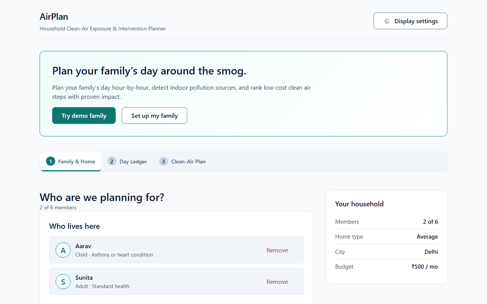
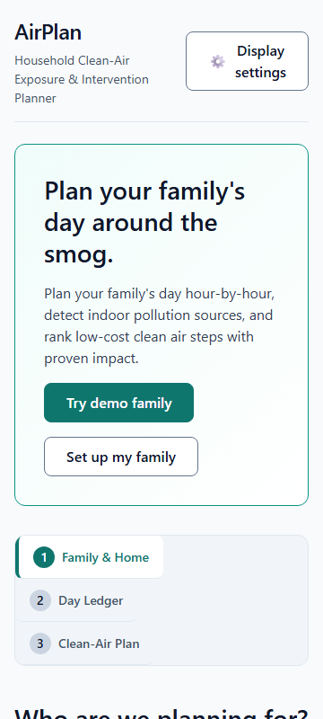
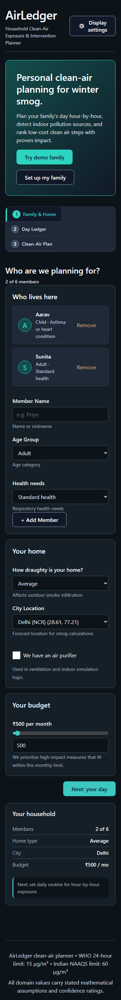

# AirPlan

> **Plan your family's day around the smog.**

[](https://github.com/Dhinakarg/AirPlan/actions)


AirPlan is an offline-first clean-air planner built for households in the Indo-Gangetic Plain and urban Global South navigating hazardous winter smog ($PM_{2.5} > 250\text{--}600\,\mu\text{g/m}^3$). It calculates personalized hour-by-hour particulate exposure, discovers clean ventilation windows, ranks low-cost interventions with transparent receipts, and provides safe, grounded AI assistance.

---

## Visual Showcase

AirPlan features a clean, responsive layout with a 3-step progress flow (Family & Home → Day Routine → Clean-Air Plan), a live household summary sidebar on desktop, and zero horizontal overflow on mobile:

| Desktop Two-Column View (Light Theme) | Desktop Two-Column View (Dark Theme) |
| :---: | :---: |
|  |  |

| Mobile Responsive View (360px Light) | Mobile Responsive View (360px Dark) |
| :---: | :---: |
|  |  |

---

## Key Features

1. **3-Step Guided Planning**: Quickly configure your household (age groups, asthma/health needs, draughtiness), map a 24-hour daily routine, and generate an actionable clean-air plan.
2. **Personalized Exposure Index**: Compares before vs. after inhaled particulate doses against an unmitigated baseline of 100.
3. **Smart Ventilation & Inversion Timing**: Pinpoints the cleanest hours to open windows and detects nocturnal thermal inversions that trap pollution at ground level.
4. **Ranked Low-Cost Actions**: Prioritizes affordable DIY interventions (like door draught-proofing, DIY Corsi-Rosenthal boxes, wet mopping) within your exact monthly budget (e.g., ₹500/month).
5. **"Ask AirPlan" AI Co-Pilot**: Powered by Google Gemini with strict guardrails—grounded in household facts, safe from medical hallucinations, with a deterministic offline fallback.
6. **Accessible & Bilingual**: Full English and Hindi (हिन्दी) support, high-contrast mode, plain language toggle, and WCAG 2.1 AA keyboard/screen-reader compliance.

---

## Quick Start (Zero Setup & 100% Offline)

AirPlan runs out of the box using bundled real-world Delhi winter smog datasets:

```bash
# 1. Clone repository
git clone https://github.com/Dhinakarg/AirPlan.git && cd AirPlan

# 2. Set up virtual environment & install dependencies
python -m venv .venv
# On Windows: .venv\Scripts\activate | On macOS/Linux: source .venv/bin/activate
pip install -r requirements.txt

# 3. Start local server
uvicorn app.main:app --host 127.0.0.1 --port 8000
```

Open **`http://127.0.0.1:8000`** in your browser.

*(Optional)* Add a `GEMINI_API_KEY` in `.env` to enable live Google Gemini generation.

---

## Architecture: Engine vs. AI Split

AirPlan enforces a strict division between deterministic physical modeling and generative language synthesis:

* **Pure Python Engine (`app/engine/`)**: Calculates all physical exposure doses, ventilation windows, and cost-benefit rankings deterministically with zero I/O and zero LLM hallucination risk.
* **Guarded AI Layer (`app/ai/`)**: Google Gemini formats narrative guidance into template-locked placeholders (`{{index_after}}`, `{{window_start}}`). Numbers are verified server-side and substituted by the Python engine.
* **Vanilla ES Modules Frontend (`static/`)**: Built with native HTML5/CSS3 and modular ES scripts ($\le 200$ lines each, zero `innerHTML`, CSP-compliant).

> For detailed component boundaries and sequence flows, see [ARCHITECTURE.md](ARCHITECTURE.md).

---

## Quality & Verification (`make check`)

Run the full automated test and quality suite:

```bash
make check
```

### Verified Test Metrics

| Quality Gate | Tool | Status & Evidence |
| :--- | :--- | :--- |
| **Python Unit & Integration** | `pytest` | **192 passed** in ~4s with **96.71% coverage** (exceeds 92% target) |
| **Frontend Tests** | `node --test` | **27 passed**, 0 failed (DOM builder, pure helpers, i18n parity, state store, enum leaks) |
| **Static Type Checking** | `mypy --strict` | **Clean** across all 35 source files (0 errors) |
| **Linter & Formatting** | `ruff` | **All checks passed** |
| **Security Auditing** | `bandit` & `pip-audit` | **0 issues identified**; no known dependency vulnerabilities |
| **Code Complexity** | `radon cc` & `radon mi` | **Grade A** (avg complexity 2.38); 100% Grade A maintainability |
| **JS File Size Budget** | Custom check | **100% compliant** (all 14 JS modules $\le 169$ lines) |

---

## Example API Usage

<details>
<summary><strong>Click to view sample <code>POST /api/v1/plan</code> payload &amp; response</strong></summary>

### Request
```json
{
  "members": [
    {
      "name": "Aarav",
      "age_group": "child",
      "sensitivity": "asthma_or_heart",
      "routine": [
        {"start_hour": 0, "end_hour": 7, "activity": "sleep", "mode": "home"},
        {"start_hour": 7, "end_hour": 14, "activity": "light", "mode": "home"},
        {"start_hour": 14, "end_hour": 16, "activity": "exercise", "mode": "outdoor"},
        {"start_hour": 16, "end_hour": 24, "activity": "rest", "mode": "home"}
      ]
    }
  ],
  "home": {"leakiness": "average", "purifier": false, "windows_open_hours": [13, 14]},
  "latitude": 28.61,
  "longitude": 77.21,
  "budget_inr": 500.0,
  "language": "en"
}
```

### Response (Excerpt)
```json
{
  "members_exposure": {
    "Aarav": {"total_dose_ug": 1184.22, "index": 61.6}
  },
  "ventilation_window": {
    "start_hour": 13, "end_hour": 15, "mean_pm25": 77.5,
    "reason": "Optimal low-PM2.5 interval for natural ventilation"
  },
  "ranked_interventions": [
    {
      "rank": 1,
      "title": "Shift outdoor exercise to cleanest hour",
      "cost_inr_per_month": 0.0,
      "effort": 2,
      "impact": 0.7
    }
  ],
  "ai_guidance": {
    "summary": "By shifting routines and sealing leaks, Aarav reduces inhaled dose by 38.4%."
  }
}
```
</details>

---

## Security & Accessibility Summary

* **Security**: Strict Content Security Policy (`default-src 'self'`), zero `innerHTML` rendering, 60 req/min rate limiting, 100 KB payload body ceiling, and coordinate rounding to $\approx 1.1\,\text{km}$ for privacy.
* **Accessibility (WCAG 2.1 AA)**: Roving focus dialogs, escape-key handlers, screen reader announcements (`aria-live`), multi-attribute AQI indicators (color + symbol + pattern), and full keyboard navigation.

---

## Medical Disclaimer

> [!CAUTION]
> **AirPlan is an informational exposure planning and environmental decision-support tool. It is not a medical device, diagnostic system, or clinical treatment platform.**  
> If anyone in your household experiences severe chest tightness, shortness of breath, gasping, or bluish lips/face, immediately discontinue application use and seek emergency medical care.

---

## Documentation Links

* [System Architecture & Invariants (ARCHITECTURE.md)](ARCHITECTURE.md)
* [Security Threat Model & Proof Matrix (SECURITY.md)](SECURITY.md)
* [Physical Assumptions & Modeling (docs/ASSUMPTIONS.md)](docs/ASSUMPTIONS.md)
* [Evaluation Methodology & Verification Evidence (docs/EVALUATION.md)](docs/EVALUATION.md)
* [3-Minute Live Demonstration Script (docs/DEMO_SCRIPT.md)](docs/DEMO_SCRIPT.md)
