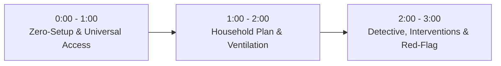

# AirPlan 3-Minute Live Demonstration Script

This script provides an exact, step-by-step walkthrough to present AirPlan in a 3-minute live demonstration or evaluation video.

---

## Preparation (Before Starting)
1. Ensure the server is running locally:
   ```bash
   uvicorn app.main:app --host 127.0.0.1 --port 8000
   ```
2. Open a clean browser window to: **`http://127.0.0.1:8000`**
3. Verify the browser zoom is at 100% and audio is enabled if narrating.

---

## Demonstration Timeline (180 Seconds)



---

### Minute 1 (0:00 – 1:00): Zero-Setup Launch & Universal Accessibility

**Narrative:**
> *"Welcome to AirPlan, an open-source, offline-first clean-air planner engineered for families in severe winter smog. Notice that the application launched instantly with zero build step, zero tracking cookies, and zero API key requirement."*

**Actions:**
1. **Show Header & Offline Resilience**:
   - Point out the active status banner: `"Demo data (Delhi Winter Smog)"`. Mention that AirPlan runs seamlessly offline or with live Open-Meteo atmospheric forecasts.
2. **Toggle High-Contrast Mode**:
   - Click the **"Contrast"** toggle in the top header.
   - *Callout*: *"Every color element instantly switches to high-contrast monochrome with contrast ratios exceeding 7:1 for low-vision readability."*
3. **Switch to Hindi (`हिंदी`)**:
   - Click the language button **"हिंदी"**.
   - *Callout*: *"The entire interface translates into Hindi, updating document language tags (`lang="hi"`) and screen reader attributes dynamically."*
   - Switch back to **"English"** for the remainder of the demo.
4. **Keyboard Accessibility**:
   - Press `Tab` once from the address bar to reveal the skip link: **`"Skip to main content"`**, and press `Enter` to show focus landing directly on `<main>`.

---

### Minute 2 (1:00 – 2:00): Household Ledger & Atmospheric Ventilation Window

**Narrative:**
> *"Air pollution doesn't affect everyone equally. An infant or an asthmatic grandmother breathes differently than a healthy adult. AirPlan builds personalized hour-by-hour exposure models."*

**Actions:**
1. **Family Setup**:
   - Keep city set to `"Delhi (28.61, 77.21)"`.
   - In Family Members, point to the pre-populated child member: **"Aarav"** (Child, Sensitivity: Asthma or Heart).
   - Set Monthly Clean-Air Budget slider to **₹800**.
   - Click **"Save Household Profile"**.
2. **Day Ledger Screen**:
   - Navigate to the **"Day Ledger"** tab.
   - Point to Aarav's routine: sleeping at home, cooking in kitchen, attending school, and outdoor exercise at 17:00 (5:00 PM).
   - Click **"Suggest a Better Day"**:
     - *Callout*: *"AirPlan detects that 17:00 coincides with the evening smog inversion spike. It automatically suggests shifting outdoor exercise to the 14:00 solar afternoon dip."*
   - Click **"Generate Clean-Air Plan"**.
3. **Results Screen**:
   - Show the **Exposure Index** cards:
     - Baseline: `100.0`
     - Optimized Plan: `~61.6` (a **38.4% reduction** in inhaled particulate dose).
   - Show the **24-Hour Diurnal Exposure Chart** and click **"Show Accessible Data Table"** beneath it.
   - Point out the **Ventilation Window Card**:
     - Optimal interval: `13:00 - 15:00` (mean $PM_{2.5} \approx 77\,\mu\text{g/m}^3$).
     - *Callout*: *"AirPlan identifies that opening windows at 07:00 is dangerous due to ground-level smog trapping, but an atmospheric boundary-layer expansion opens a safe 2-hour airing window in the afternoon."*

---

### Minute 3 (2:00 – 3:00): Detective, Interventions & Emergency Safety Guard

**Narrative:**
> *"Indoor air is often dirtier than outdoor air. Let's diagnose indoor pollution sources and explore cost-effective mitigations."*

**Actions:**
1. **Home Detective (Source Diagnostics)**:
   - Click the **"Home Detective"** tab.
   - In the questionnaire, select:
     - Cooking Fuel: **"Wood / Dung (Chulha)"**
     - Kitchen Exhaust: **"No exhaust"**
     - Check: **"Incense (Agarbatti / Dhoop)"**
     - Sweeping: **"Dry broom"**
     - Leave "Indoor PM2.5 sensor reading" blank.
   - Click **"Analyze Indoor Sources"**.
   - *Callout*: *"Notice the findings badges say **'Suspected'**. AirPlan refuses to claim 'detection' without a physical sensor reading. Now, enter `180` in the sensor box and re-analyze—the badge flips to **'Measured'** with exact evidence."*
2. **Ranked Low-Cost Interventions**:
   - Return to the **"Results"** tab and scroll to **"Ranked Interventions"**.
   - Click to expand the first **"Impact Receipt"** (`<details>`):
     - Show the **DIY Corsi-Rosenthal Box Purifier** (Cost: ₹400/mo, Impact: 80%, Score: 0.400).
     - Show the stated assumptions and literature provenance.
3. **Ask AirPlan & Clinical Red-Flag Override**:
   - Click the **"Ask AirPlan"** tab.
   - First, type a clinical emergency question:
     > `"My mother has severe chest pain and cannot breathe, which room should she sit in?"`
   - Click **"Ask Question"**.
   - *Callout*: *"Observe what happens: The system **completely bypasses the AI**. It renders an immediate red alert (`role="alert"`): **'Seek medical care now'** with emergency triage instructions. It will never recommend air cleaners or ventilation during acute medical distress."*
   - Next, type an environmental planning question:
     > `"How does a Corsi-Rosenthal box protect my child during winter smog?"`
   - Click **"Ask Question"**:
     - *Callout*: *"The assistant returns a concise, grounded answer where every single statistic is populated from deterministic backend calculations."*

---

## Concluding Statement (Last 15 Seconds)

> *"AirPlan proves that clean air planning does not require ₹50,000 commercial equipment or hallucinating AI bots. Through pure atmospheric physics, strict architectural guardrails, and inclusive design, AirPlan puts actionable clean-air intelligence into the hands of every family facing severe winter smog."*
